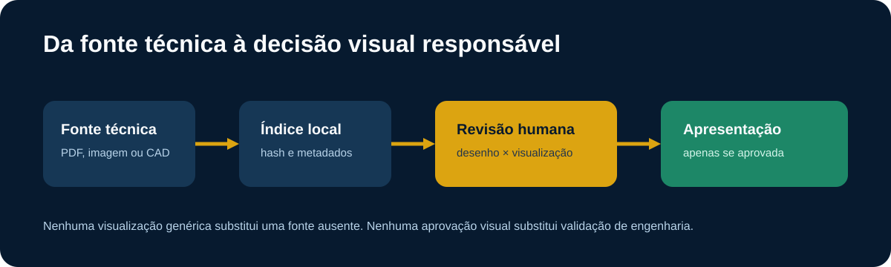
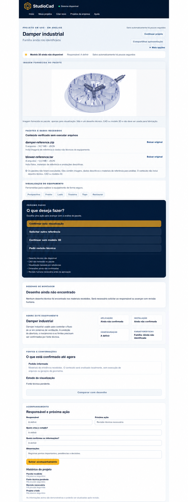
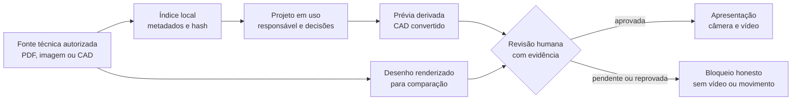

# StudioCad — estudo de caso de engenharia para projetos industriais

> Edição pública e sanitizada de um projeto de estação visual para decisões técnicas.
> **Não inclui documentos, modelos CAD, NAS, IPs, credenciais ou dados de qualquer empresa.**

[](https://github.com/Mayconxzdev/StudioCad/actions/workflows/ci.yml)


## Visão do produto



> Reconstrução visual sanitizada a partir de um fluxo real validado localmente. A composição, os estados e o padrão de decisão foram preservados; marcas, arquivos, pessoas, datas, documentos e quaisquer dados de terceiros foram substituídos por conteúdo demonstrativo. Não é uma captura de tela de cliente nem uma fonte técnica real.

### Uso interno e assistência por IA

A versão privada está funcional e é utilizada pelo gestor da empresa para visualizar projetos e produzir estudos e desenhos visuais assistidos por IA.

A camada de IA utiliza modelos locais e remotos por meio de **Ollama, Hermes e OpenRouter**, com fallback entre provedores quando necessário. A indisponibilidade de um modelo não deve bloquear as funções principais de organização, conversão e visualização.

As saídas geradas por IA são tratadas como apoio conceitual e visual. Elas não substituem CAD de fabricação, cálculo de engenharia ou aprovação técnica. Qualquer resultado relevante exige revisão humana antes de ser utilizado ou apresentado. 

## Por que este projeto existe

Em fluxos industriais, informações importantes costumam ficar distribuídas entre desenhos, PDFs, imagens, CADs e arquivos compactados. O problema não é apenas abrir arquivos: é permitir que alguém entenda o equipamento, compare evidências e tome uma decisão sem transformar uma referência incompleta em uma apresentação enganosa.

O StudioCad foi pensado como uma estação visual de projetos que separa claramente:

- **fonte histórica** — preservada e somente leitura;
- **projeto em uso** — decisões, responsáveis e evidências locais;
- **visualização derivada** — nunca confundida com CAD de fabricação;
- **aprovação humana** — obrigatória antes de vídeo ou movimento mecânico;
- **dados públicos de portfólio** — sanitizados e demonstrativos.

## Destaques técnicos

| Tema | Decisão de engenharia |
|---|---|
| Fontes reais | A origem e o hash acompanham a visualização derivada. Nenhuma geometria genérica substitui CAD ausente. |
| Segurança de arquivos | ZIP, TAR e JSON são inventariados sem executar scripts, macros ou conteúdo recebido. Caminhos inseguros, entradas especiais, criptografia e compressão suspeita são rejeitados. |
| Decisão visual | A aprovação compara desenho × visualização e registra responsável/evidência; ela não é apresentada como validação de engenharia. |
| Animação | Movimento só é habilitado quando existe perfil confirmado de componente, eixo, pivô, limites e responsável. |
| Vídeo | O pipeline bloqueia apresentação quando a fonte/seleção visual não foi aprovada. Arquivo MP4 existente não equivale a homologação cinematográfica. |
| Privacidade | Caminhos internos, endereços de rede, usuários, documentos e dados comerciais não entram na versão pública. |

## O que está neste repositório

Este é um **portfolio edition**, não uma cópia do sistema operacional da empresa. Ele contém:

- uma implementação Node.js independente de inventário seguro de ZIP/TAR/JSON;
- uma função de redação de manifestos para exportação pública;
- testes reproduzíveis com fixtures sintéticas;
- documentação de arquitetura, limites e estratégia de validação;
- CI no GitHub Actions;
- uma reconstrução visual sanitizada para tornar a experiência avaliável sem expor o ambiente original.

O que foi propositalmente removido:

- arquivos CAD, desenhos, PDFs e fotos reais;
- nomes de clientes, projetos, pessoas e produtos internos;
- endereço/IP do NAS, caminhos locais e de rede;
- banco de índice, logs operacionais, cache e instaladores;
- credenciais, certificados e qualquer segredo.

## Arquitetura do produto real, em alto nível


### Pipeline privado de conversão

A versão operacional utiliza uma cadeia de conversão com **FreeCAD, Blender e Assimp**, aplicando fallback conforme o formato, a estrutura e a qualidade do arquivo recebido.

A edição pública não distribui esses executáveis, arquivos técnicos ou integrações empresariais. Ela preserva os princípios de origem verificável, hash, inspeção segura, aprovação humana e bloqueio de apresentações sem fonte adequada.

Leia [docs/architecture.md](docs/architecture.md), [docs/privacy-and-security.md](docs/privacy-and-security.md) e [docs/validation.md](docs/validation.md) para entender as decisões, limites e critérios de qualidade.

## Executar a edição pública

Pré-requisito: Node.js 20 ou superior.

```bash
npm test
```

O comando cria fixtures temporárias e valida o inventário seguro e a redação de manifestos. Ele não acessa rede, NAS ou dados externos.

## Exemplo de uso

```js
const { inspectPackage } = require('./src/safe-package-inspector.cjs');

const report = await inspectPackage({
  filePath: './entrada-do-cliente.zip',
  originalName: 'entrada-do-cliente.zip'
});

console.log(report.state); // inspected | rejected
console.log(report.totals); // PDFs, imagens, CADs, JSONs e scripts encontrados
```

Uma inspeção bem-sucedida apenas informa o conteúdo. Ela **não** aprova o arquivo como desenho, CAD, componente móvel ou vídeo.

## Resultados e honestidade de escopo

O sistema interno teve validações de índice local, conversão CAD rastreável, prévias, comparação visual, bloqueios de apresentação, tarefa agendada e acesso em rede local. Esta publicação demonstra os padrões técnicos e os controles, mas não reivindica que o leitor tenha acesso à infraestrutura, aos arquivos ou às homologações privadas.

Em especial, esta edição não demonstra um vídeo de engenharia aprovado nem afirma que uma animação representa funcionamento físico. Esses resultados exigem fonte técnica adequada e revisão humana responsável.

## Competências demonstradas

- Node.js e APIs HTTP locais;
- segurança de manipulação de arquivos e defesa contra path traversal/zip bomb;
- rastreabilidade por hash e manifestos portáveis;
- modelagem de fluxos de aprovação humana;
- UX para usuários não técnicos;
- arquitetura de conversão CAD e apresentação com limites explícitos;
- testes automatizados e CI;
- documentação técnica orientada a produto e risco.

## Autor

**Maycon Ferreira**

GitHub: [@Mayconxzdev](https://github.com/Mayconxzdev)
E-mail: mayconxz00dev@gmail.com

---

Este repositório é um recorte público de portfólio. Marcas, arquivos, infraestrutura e informações de terceiros não foram incluídos.
