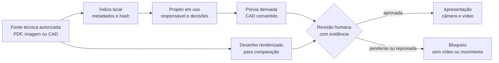

# StudioCad — estação visual para projetos industriais

> Edição pública e sanitizada de um projeto que desenvolvi para organizar referências técnicas, visualizar arquivos e apoiar decisões visuais.
> **Não inclui documentos, modelos CAD, NAS, IPs, credenciais ou dados de qualquer empresa.**

[](https://github.com/Mayconxzdev/StudioCad/actions/workflows/ci.yml)


## Visão geral


A imagem acima é uma reconstrução sanitizada de um fluxo que validei localmente. Mantive a estrutura, os estados e o padrão de decisão, mas substituí marcas, arquivos, pessoas, datas e documentos por conteúdo fictício. Não é uma captura de cliente nem uma fonte técnica real.

A versão privada está funcional e é utilizada pelo gestor da empresa para visualizar projetos e produzir estudos e desenhos visuais com apoio de IA.

## Problema que trabalhei

Em projetos industriais, informações importantes ficam distribuídas entre desenhos, PDFs, imagens, arquivos CAD e pacotes compactados. O desafio não é apenas abrir esses arquivos: é manter a origem, comparar referências e impedir que uma visualização incompleta seja tratada como desenho de fabricação ou validação de engenharia.

Por isso, organizei o fluxo em quatro partes:

- **fonte histórica:** preservada e somente leitura;
- **projeto em uso:** decisões, responsáveis e arquivos selecionados;
- **visualização derivada:** identificada como conversão ou estudo visual;
- **aprovação humana:** obrigatória antes de apresentação, vídeo ou movimento mecânico.

## IA e conversão de arquivos

A camada de IA utiliza modelos locais e remotos por meio de **Ollama, Hermes e OpenRouter**, com fallback quando necessário. A indisponibilidade de um modelo não bloqueia as funções principais de organização, conversão e visualização.

As saídas de IA servem como apoio conceitual e visual. Elas não substituem CAD de fabricação, cálculo de engenharia ou aprovação técnica. Essa fronteira, os riscos de provedores, proveniência e human-in-the-loop estão registrados em [`docs/AI_SYSTEM_CARD.md`](docs/AI_SYSTEM_CARD.md).

Na versão privada, a conversão usa **FreeCAD, Blender e Assimp**, escolhendo alternativas conforme o formato e a estrutura do arquivo. A edição pública não distribui executáveis, arquivos técnicos ou integrações empresariais.

## Decisões técnicas

| Tema | Como tratei |
|---|---|
| Origem dos arquivos | A fonte e o hash acompanham cada visualização derivada. Geometria genérica não substitui CAD ausente. |
| Pacotes recebidos | ZIP, TAR e JSON são inventariados sem executar scripts, macros ou conteúdo recebido. |
| Arquivos suspeitos | Path traversal, entradas especiais, criptografia e compressão anormal são rejeitados. |
| Revisão visual | A comparação desenho × visualização registra responsável e decisão, sem ser apresentada como validação de engenharia. |
| Movimento | Só é habilitado quando existem componente, eixo, pivô, limites e responsável confirmados. |
| Vídeo | A apresentação fica bloqueada quando a fonte e a seleção visual não foram aprovadas. |
| Privacidade | Caminhos internos, endereços de rede, usuários, documentos e dados comerciais ficam fora da versão pública. |

## Conteúdo desta edição pública

- implementação Node.js para inventário seguro de ZIP, TAR e JSON;
- redação de manifestos para exportação pública;
- testes com arquivos sintéticos;
- documentação de arquitetura, privacidade, IA e limites;
- CI no GitHub Actions;
- reconstrução visual sanitizada do fluxo de revisão.

Foram removidos:

- CADs, desenhos, PDFs e fotos reais;
- nomes de clientes, projetos, pessoas e produtos internos;
- endereços do NAS, caminhos locais e de rede;
- banco de índice, logs operacionais, cache e instaladores;
- credenciais, certificados e segredos.

## Arquitetura em alto nível



Leia [docs/architecture.md](docs/architecture.md), [docs/AI_SYSTEM_CARD.md](docs/AI_SYSTEM_CARD.md), [docs/privacy-and-security.md](docs/privacy-and-security.md) e [docs/validation.md](docs/validation.md) para os detalhes.

## Executar a edição pública

Pré-requisito: Node.js 20 ou superior.

```bash
npm test
```

O comando cria fixtures temporárias e valida o inventário seguro e a redação de manifestos. Ele não acessa rede, NAS ou dados externos.

## Exemplo de uso

```js
const { inspectPackage } = require('./src/safe-package-inspector.cjs');

const report = await inspectPackage({
  filePath: './entrada-do-cliente.zip',
  originalName: 'entrada-do-cliente.zip'
});

console.log(report.state); // inspected | rejected
console.log(report.totals); // PDFs, imagens, CADs, JSONs e scripts encontrados
```

Uma inspeção bem-sucedida informa o conteúdo do pacote, mas não aprova o arquivo como desenho, CAD, componente móvel ou vídeo.

## Estado e limites

A versão privada passou por validações de índice local, conversão CAD rastreável, prévias, comparação visual, bloqueios de apresentação, tarefa agendada e acesso em rede local.

A edição pública preserva os padrões técnicos e de segurança, mas não disponibiliza a infraestrutura, os arquivos ou as aprovações privadas. Também não afirma que uma animação representa o funcionamento físico de um equipamento.

## Tecnologias e práticas

- Node.js e APIs HTTP locais;
- segurança no processamento de arquivos e defesa contra path traversal e zip bomb;
- rastreabilidade por hash e manifestos portáveis;
- fluxos de aprovação humana;
- interface para usuários não técnicos;
- conversão CAD com limites explícitos;
- testes automatizados e CI;
- documentação técnica de produto, IA e risco.

## Autor

**Maycon Ferreira**

GitHub: [@Mayconxzdev](https://github.com/Mayconxzdev)  
E-mail: mayconxz00dev@gmail.com

---

Este repositório é um recorte público. Marcas, arquivos, infraestrutura e informações de terceiros não foram incluídos.
